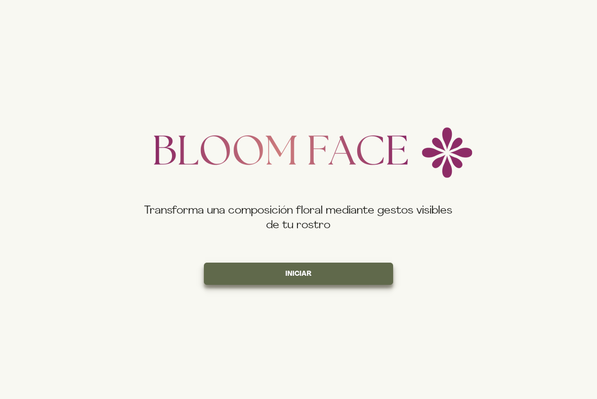

# BloomFace

**Creación visual a partir de gestos faciales y composiciones florales.** Proyecto final de Procesamiento Digital de Imágenes de la Universidad Autónoma de Occidente, en el marco del macroproyecto **Análisis de la Expresión Humana en el Arte y la Cultura**.

BloomFace propone una experiencia artística local en la que la persona participa mediante movimientos visibles de su rostro. El sistema vincula esos gestos con etapas de apertura de una flor y genera una respuesta visual mediante modelos preentrenados.

**Autores:** Catalina Ortiz González, Juan Andrés Escobar Sánchez y Juan David Romero Rada.

Esta versión incorpora la **documentación, la organización de archivos y la preparación de ejecución revisadas después del merge del 23 de noviembre de 2026**. Los cambios se revisaron primero en una copia y se integraron en el repositorio con autorización del equipo. El detalle de cambios y las verificaciones están en [registro de revisión e integración](docs/revision.md).

## Qué hace

La aplicación de escritorio para Windows recibe la webcam, obtiene señales de movimiento con MediaPipe Face Landmarker y confirma un gesto tras tres segundos continuos. Stable Diffusion 1.5, ControlNet Scribble y LCM-LoRA generan una acuarela. Se toma **un gesto por ronda**; al mostrar la flor se pausa y el botón **Iniciar** permite otra ronda.

| Gesto | Etapa floral |
|---|---|
| Ceño fruncido | Cerrada |
| Reposo | Punto medio |
| Sonrisa | Abierta |
| Boca abierta | Más abierta |

La interfaz, las animaciones, las reglas de interacción y el generador proceden del código del merge. La revisión añade preparación del entorno floral y organiza la documentación; no cambia los umbrales ni las guías.

## Abrir el proyecto

1. Abre **la carpeta completa del proyecto** en VS Code para evitar ejecutar otra copia del proyecto.
2. Abre `BloomFace_Instalar_y_Probar.ipynb`.
3. Selecciona un kernel Python local funcional. Si VS Code solicita `ipykernel`, acepta instalarlo. El notebook necesita ese kernel para ejecutar su primera celda.
4. Pulsa **Run All / Ejecutar todo** y espera a que termine la preparación. Obtendrá Python 3.12 si hace falta, instalará los dos entornos y descargará los modelos públicos. La primera vez requiere Internet y varios GB de disco.
5. En BloomFace pulsa **INICIAR → flecha → Iniciar**. Mantén un gesto tres segundos y espera la acuarela. Después pulsa **Iniciar** para otra flor.

Las siguientes ejecuciones reutilizan los recursos. DirectML intenta usar una GPU compatible; la aplicación recupera el gesto vigente en CPU si la GPU falla o supera el tiempo de espera. CPU puede tardar bastante más. El sistema requiere memoria y controladores suficientes; no se garantiza la misma velocidad en cualquier equipo. Consulta [instalación y solución de problemas](docs/instalacion.md).

## Documentación del proyecto

| Contenido solicitado | Documento |
|---|---|
| Problemática, justificación, objetivos y solución | [Descripción del proyecto](docs/proyecto.md) |
| Técnicas de PDI y visión computacional implementadas | [Correspondencia técnica](docs/metodologia.md#técnicas-de-procesamiento-de-imágenes-y-visión-computacional) |
| Fundamento artístico y fuentes técnicas | [Referencias](docs/referencias.md) |
| Componentes, conexiones y funcionamiento | [Arquitectura y diagramas](docs/arquitectura.md) |
| Etapas de desarrollo, técnicas y modelos | [Metodología e implementación](docs/metodologia.md) |
| Datos, recursos, procedencia y acceso | [Datos y modelos](docs/datos.md) |
| Prototipo, funciones, uso y evidencias | [Interfaz y manual](docs/interfaz.md) |
| Pruebas, métricas, resultados y análisis | [Resultados](docs/resultados.md) y [verificación reproducible](docs/verificacion.md) |
| Resultados principales, límites y mejoras | [Conclusiones](docs/conclusiones.md) |
| Cobertura de los requisitos de la imagen | [Lista de entrega](docs/entrega.md) |

## Ejecutable portátil y desarrollo

La carpeta de código **no incluye un `BloomFace.exe` ni un ZIP portátil**. Las instrucciones para usar un portátil completo o construirlo están en [instalación](docs/instalacion.md). El paquete de distribución debe identificarse por su versión y verificarse en el equipo de entrega. Los recursos grandes quedan fuera del código fuente y los prepara el notebook.

El código se organiza en `bloomface/`, el cuaderno floral activo en `notebooks/` y las pruebas en `tests/`. Los experimentos anteriores y la bitácora original se conservan en [antecedentes](docs/antecedentes/README.md). Los pesos y entornos se generan en `.venv/`, `bloomface/models/` y `floral_runtime/`, excluidos de Git.

La documentación distingue los resultados históricos del proyecto, las comprobaciones de esta copia y las pruebas con participantes aún pendientes. El 97,92 % de la CNN anterior corresponde a ese experimento, no a MediaPipe.
