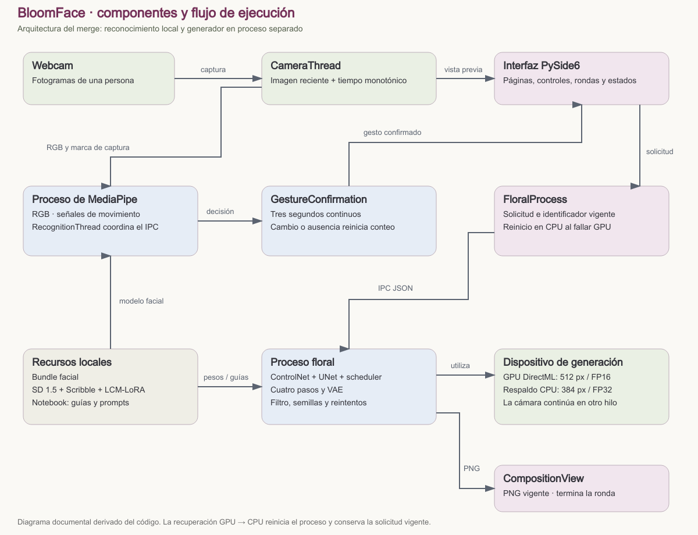
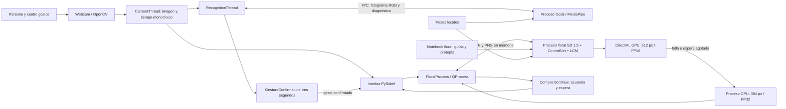
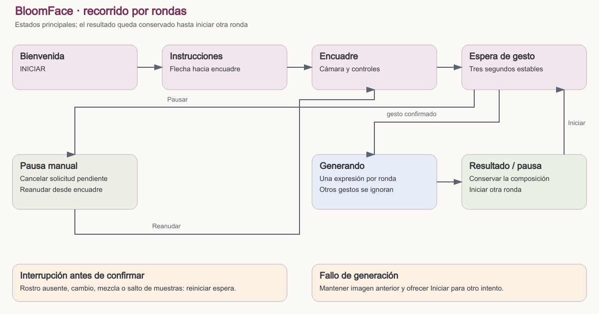

# Arquitectura del sistema

## Componentes y conexiones

El enlace GPU → CPU representa el reinicio del proceso floral por el controlador; no es una transferencia directa de tensores entre ambos dispositivos.

| Responsabilidad | Archivo del repositorio |
|---|---|
| Ventana, páginas, estados y rondas | `bloomface/app.py` |
| Captura y marca temporal | `bloomface/camera.py` |
| Vista previa y borde de confirmación | `bloomface/camera_preview.py` |
| Imagen y animación de la primera flor | `bloomface/composition_view.py` |
| Modelo facial y reglas de señales | `bloomface/classifier.py` |
| Proceso de inferencia facial | `bloomface/inference_worker.py` |
| Muestreo, IPC y señales Qt | `bloomface/recognition.py` |
| Confirmación temporal | `bloomface/decision.py` |
| Generación, solicitudes y respaldo CPU | `bloomface/floral.py` |
| Modelos de difusión e inferencia | `bloomface/floral_worker.py` |
| Guías, descripciones y mapa de etapas | `notebooks/BloomFace_Generacion_Floral.ipynb` |

## Estados de la experiencia

```mermaid
stateDiagram-v2
    [*] --> Bienvenida
    Bienvenida --> Instrucciones: INICIAR
    Instrucciones --> Encuadre: flecha
    Encuadre --> Espera: Iniciar
    Espera --> Espera: gesto cambia / ambiguo / rostro ausente
    Espera --> Generando: gesto estable al menos tres segundos
    Generando --> Resultado: acuarela vigente
    Resultado --> Espera: Iniciar otra ronda
    Espera --> PausaManual: Pausar
    Generando --> PausaManual: Pausar y cancelar pendiente
    PausaManual --> Encuadre: Reanudar
    Generando --> Resultado: fallo; conservar imagen anterior y permitir otro intento
    Encuadre --> ErrorCamara: fallo de captura
    Espera --> ErrorCamara: fallo de captura
    ErrorCamara --> Encuadre: reintento exitoso
```

El estado Resultado conserva la flor y está en pausa para el usuario. Al comenzar otra ronda se reinicia el conteo. Una pausa manual utiliza la acción Reanudar. Durante la generación no se admiten nuevas confirmaciones de gesto en esa ronda.

## Ejecución y fallos

La captura conserva el fotograma más reciente; el reconocimiento toma hasta ocho muestras por segundo. La confirmación utiliza la marca temporal de captura, por lo que una respuesta atrasada no equivale a sostener un gesto nuevo. El generador se comunica con mensajes por líneas y devuelve un PNG codificado en base64. Los identificadores permiten descartar respuestas canceladas.

El controlador arranca un proceso GPU y utiliza un temporizador de 120 segundos. Si falla o se agota la espera, inicia el proceso CPU y conserva la solicitud vigente. Una salida rechazada por el filtro permite otra ronda. Cerrar libera los procesos y la captura.
