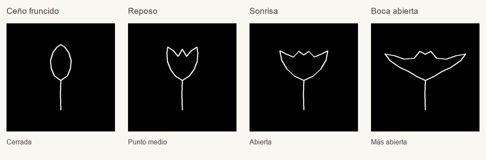

# Datos, modelos y recursos

## Datos de la experiencia actual

| Recurso | Uso y ubicación | Acceso / tratamiento |
|---|---|---|
| Fotogramas de webcam | Captura local en `camera.py` | Se procesan en memoria; el recorrido inspeccionado no guarda ni sube fotos |
| Señales faciales | Cinco coeficientes de movimiento en `classifier.py` | Se usan para reglas; la referencia personal se guarda en `bloomface/models/mediapipe/reposo.json` |
| Guías florales propias | Contornos y prompts en el notebook floral activo | Incluidos en el repositorio; se usan durante la generación |
| Acuarelas | PNG devuelto al proceso de interfaz | El recorrido principal conserva la composición en memoria durante la sesión |
| Recursos de interfaz | Logo PNG, SVG maestro y dos fuentes activas | Incluidos; se mantienen los avisos de procedencia |

### Visualización de las guías incluidas

La figura se dibuja desde los contornos y el mapa de etapas del notebook. Representa las condiciones de entrada, no cuatro resultados de difusión ni una medida de precisión.

## Modelos públicos

| Modelo | Función | Fuente |
|---|---|---|
| MediaPipe Face Landmarker | Landmarks y señales de expresión | [Bundle oficial](https://storage.googleapis.com/mediapipe-models/face_landmarker/face_landmarker/float16/1/face_landmarker.task) y [documentación](https://developers.google.com/edge/mediapipe/solutions/vision/face_landmarker?tab=Python) |
| Stable Diffusion 1.5 | Base de generación | [Repositorio del modelo](https://huggingface.co/stable-diffusion-v1-5/stable-diffusion-v1-5) |
| ControlNet Scribble | Condicionamiento por guía | [Repositorio del modelo](https://huggingface.co/lllyasviel/control_v11p_sd15_scribble) |
| LCM-LoRA SD 1.5 | Adaptador usado en el recorrido corto | [Repositorio del adaptador](https://huggingface.co/latent-consistency/lcm-lora-sdv1-5) |

El código prepara los archivos FP16 safetensors necesarios y las configuraciones, sin descargar todas las variantes de cada repositorio. CPU los carga en FP32. El modelo facial registra URL y SHA256 en su JSON adyacente; el preparador floral registra las revisiones públicas descargadas. Deben conservarse las fichas y avisos de los recursos al preparar una distribución.

## Datos históricos disponibles por referencia

La bitácora original describe un piloto LibreFace con 898 imágenes únicas de tres personas: 225 de reposo, 223 de sonrisa, 225 de boca abierta y 225 de ceño. Se describen particiones por persona de 298/300/300 imágenes. Es una descripción histórica no recontada sobre fotos en esta copia. El notebook correspondiente se conserva en [antecedentes](antecedentes/README.md).

La carpeta recibida no incluye esas fotos ni un enlace autorizado específico para descargarlas. Esta ausencia limita la reproducción de ese piloto histórico; la aplicación actual usa MediaPipe preentrenado y sus datos en vivo. Tampoco se incluyen las fotografías propias y pesos LoRA del Parcial 3 como recursos activos del generador actual. La reproducción de esos experimentos requiere que el equipo disponga de sus datos autorizados y su configuración original.

## Diseño y tipografías

El logo SVG se mantiene como original editable y el PNG como recurso cargado por la interfaz y su animación. Solo Regular y TextBold se empaquetan desde la carpeta de fuentes activa. Las siete variantes restantes están archivadas con su aviso. El archivo recibido de Agrandir declara «Personal Use Only»; su alcance de redistribución debe verificarse por el equipo antes de publicar un paquete con esas fuentes. El código tiene una tipografía del sistema como alternativa si Agrandir no carga. Esta revisión conserva los archivos recibidos y no afirma una licencia abierta de todo el repositorio.

## Relación con la propuesta inicial

La [propuesta del equipo](antecedentes/Propuesta_original_BloomFace.docx) planteaba entrenar una CNN propia y transformar fotografías de flores. Su problemática artística se conserva. Los datos y modelos de ejecución de esta versión corresponden a MediaPipe preentrenado, guías incluidas y difusión condicionada; la evaluación del sistema actual debe utilizar su propio protocolo y resultados.
