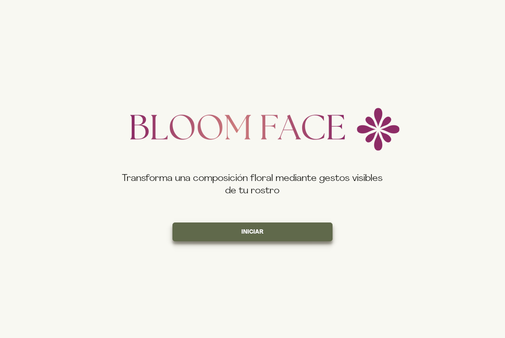
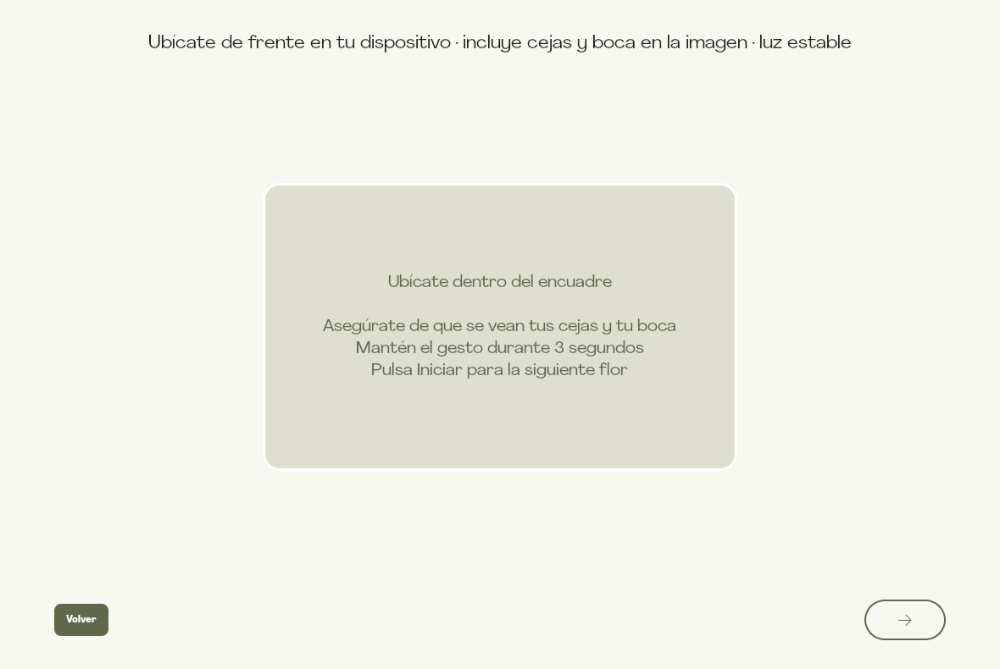
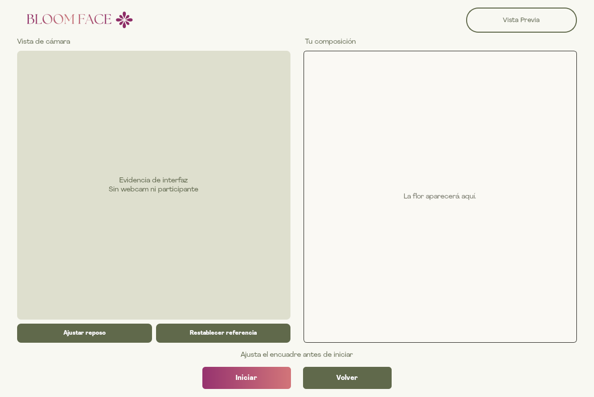
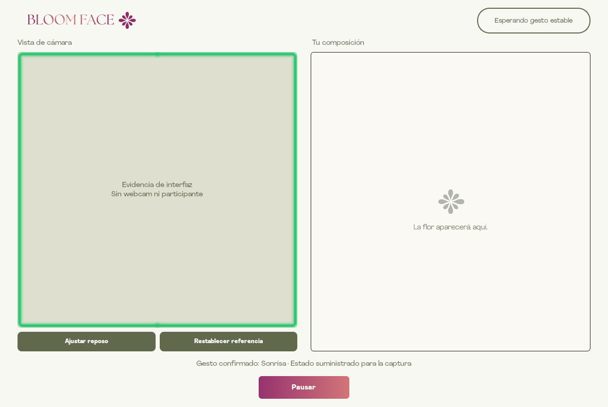
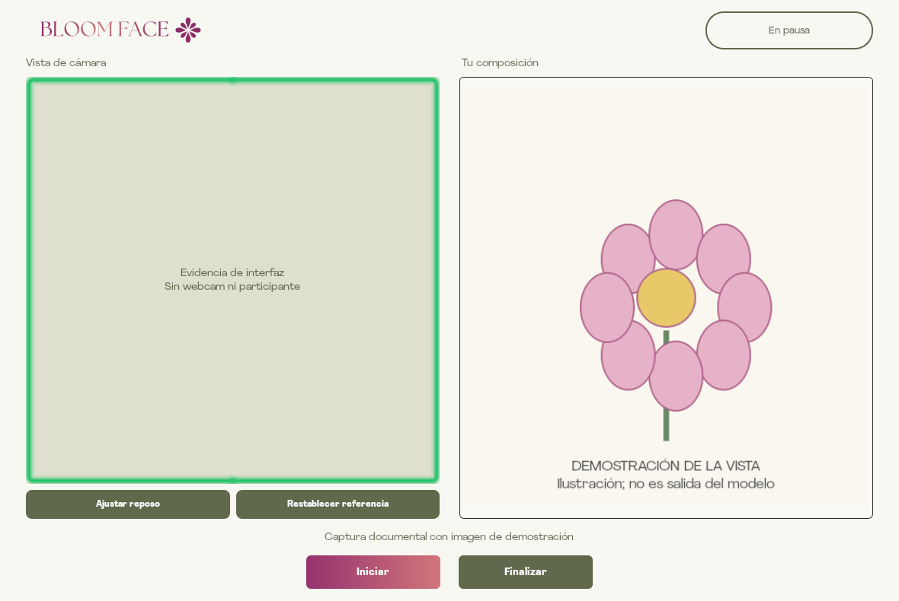

# Interfaz y manual de uso

## Diseño implementado

La versión utiliza la marca BloomFace, Agrandir Regular/TextBold, superficies claras, botones magenta y verde oliva, una vista de cámara y un panel de composición. La referencia verificable es la interfaz incluida después del merge. No se afirma paridad píxel a píxel con un diseño externo que no se haya contrastado.

Las siguientes capturas se renderizan con Qt a partir del código de esta copia, sin abrir la webcam. Los estados de cámara, carga y resultado utilizan señales o datos suministrados para la evidencia; no constituyen un ensayo con participantes.

### Material audiovisual del equipo

- [Video demostrativo](https://drive.google.com/drive/folders/1QnlKGPzSLxmXWYSKPR-9ky_ccc3YyCzO?usp=drive_link): carpeta con la demostración aportada por el equipo.
- [Evidencias visuales de BloomFace](https://drive.google.com/drive/folders/1roSEUYetW253kGcOQmd0Q32GxQD35YFs?usp=sharing): carpeta con el material de evidencia aportado por el equipo.

El material externo complementa las capturas documentales incluidas a continuación. Estas capturas conservan su identificación como estados controlados; no se presentan como fotografías de las pruebas con participantes.

## Bienvenida

Pulsa **INICIAR** para leer las instrucciones.

### Instrucciones y encuadre

Incluye cejas y boca, mantén luz estable y ubícate de frente. La flecha abre la vista principal e intenta abrir la cámara. Si falla, usa el reintento después de revisar conexión y permisos.

### Ronda y confirmación

Pulsa **Iniciar**. Mantén uno de los gestos de la tabla del README durante tres segundos. Dos tramos del borde avanzan desde la parte inferior y se unen en verde al confirmar. Si se pierde el rostro o cambia el gesto, se reinicia el conteo.

El ajuste opcional **Ajustar reposo** toma 16 muestras válidas del rostro relajado. **Restablecer referencia** elimina ese ajuste local y exige volver a iniciar el reconocimiento. La referencia debe corresponder a la persona que usa la experiencia.

### Generación y resultado

La primera solicitud muestra los ocho pétalos extraídos del logo como indicador de espera. La carga del modelo se suma al tiempo de esa primera imagen. Las rondas siguientes mantienen la composición anterior durante la generación. Si GPU falla, la espera puede continuar al cargar CPU.

La última captura utiliza una ilustración identificada como demostración para verificar el espacio de composición. Una imagen real se incorpora solo si existe evidencia de inferencia documentada en [resultados](resultados.md).

Cuando aparece la acuarela, la ronda termina en pausa. Pulsa el mismo **Iniciar** para otra flor. Durante una generación, otros gestos no modifican la ronda actual. **Pausar** permite conservar la vista y cancelar la petición; **Reanudar** vuelve al recorrido de encuadre y reconocimiento.

## Fallos y limitaciones visibles

Una pérdida de rostro muestra una indicación de encuadre. Un fallo de cámara permite reintentar. Un rechazo de generación conserva la imagen anterior y permite otra ronda. Cerrar libera la captura y los procesos. La revisión manual de estas situaciones se propone en [verificación](verificacion.md).
