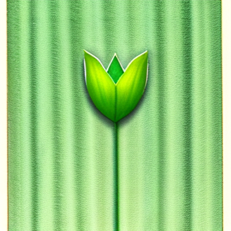

# Resultados y análisis

## Cómo interpretar la evidencia

Este documento presenta el registro exploratorio del equipo con cinco participantes y un ejemplo técnico de generación en CPU. Cada prueba se acompaña de su alcance y sus limitaciones.

## Evaluación exploratoria con cinco participantes

### Protocolo y fuente

El equipo registró 20 intentos: cinco participantes identificados como P1–P5 hicieron una vez ceño fruncido, reposo, sonrisa y boca abierta. Se consignaron el gesto confirmado, la aparición de una imagen, la etapa mostrada, el tiempo desde la confirmación hasta la imagen visible, la marca de primera generación y el dispositivo declarado en observaciones. Los resultados se atribuyen a este registro manual; la lectura de la hoja no constituye una revisión independiente de cada intento.

Fuente: [registro del equipo en Google Sheets](https://docs.google.com/spreadsheets/d/1OFLhjNNrDSzu4YTQnhB6HBm7XOI1AeTvDD-IIqwWSMc), consultado el 23 de noviembre de 2026. La [instantánea local](evidencias/validacion_participantes_2026-11-23.json) conserva los valores originales y las advertencias de interpretación para reproducir los cálculos sin depender de cambios posteriores en la hoja. El acceso a la hoja depende de los permisos del equipo.

### Video demostrativo y evidencias

- [Video demostrativo](https://drive.google.com/drive/folders/1QnlKGPzSLxmXWYSKPR-9ky_ccc3YyCzO?usp=drive_link): carpeta con la demostración aportada por el equipo.
- [Evidencias visuales de BloomFace](https://drive.google.com/drive/folders/1roSEUYetW253kGcOQmd0Q32GxQD35YFs?usp=sharing): carpeta con el material de evidencia aportado por el equipo.

Estos enlaces fueron suministrados por el equipo para acompañar los resultados. La incorporación de las carpetas no constituye una revisión independiente de su contenido ni una comprobación de cada intento. Para facilitar la trazabilidad, se debe vincular cada registro con el archivo o momento de video correspondiente.

### Cumplimiento funcional observado

| Indicador | Numerador / denominador | Resultado |
|---|---|---|
| Gesto confirmado igual al solicitado | 20/20 intentos | 100 % |
| Imagen mostrada al terminar | 20/20 intentos | 100 % |
| Etapa mostrada igual a la esperada para el gesto solicitado | 20/20 intentos | 100 % |

| Gesto solicitado | Etapa esperada | Reconocimientos correctos | Imágenes con etapa correspondiente |
|---|---|---|---|
| Ceño fruncido | Cerrada | 5/5 | 5/5 |
| Reposo | Punto medio | 5/5 | 5/5 |
| Sonrisa | Abierta | 5/5 | 5/5 |
| Boca abierta | Más abierta | 5/5 | 5/5 |

No se registraron errores de reconocimiento, ausencia de imagen ni discrepancias de etapa en estos 20 intentos. El 100 % expresa el cumplimiento observado en esta muestra; no una precisión general de MediaPipe ni una evaluación de emociones internas.

### Tiempos según el dispositivo registrado

Las observaciones atribuyen 16 intentos (P1, P2, P3 y P5) a GPU dedicada y cuatro (P4) a «CPU de gráficos integrados». Esta última expresión no distingue CPU de GPU integrada, por lo que el grupo se denomina **CPU según el registro**, pendiente de verificar el backend efectivo.

Para comparar la espera después de la carga, se incluyen únicamente filas con «No» en la columna «¿Primera tras cargar?». No se descartan tiempos por ser altos: los 24,90 s de P3–ceño permanecen incluidos porque así está marcado el intento.

| Grupo según observaciones | Intentos totales | Mediciones sin primera carga | Promedio sin primera carga | Mínimo | Máximo |
|---|---|---|---|---|---|
| GPU dedicada | 16 | 12 | 13,20 s | 8,90 s | 24,90 s |
| CPU según el registro (P4) | 4 | 3 | 50,90 s | 46,70 s | 56,50 s |

El promedio se calcula como suma de los tiempos elegibles dividida por su número: 158,40/12 = 13,20 s y 152,70/3 = 50,90 s. La relación entre promedios es 50,90/13,20 = 3,86. Esto indica una mayor espera en el grupo de P4, sin demostrar una aceleración atribuible únicamente a GPU: los grupos incluyen participantes distintos y no documentan controles completos de hardware ni resolución por intento. El código configura perfiles diferentes para CPU (384 px, FP32) y DirectML (512 px, FP16).

### Primera carga y calidad de los datos

Hay cinco intentos marcados como primera generación: cuatro en el grupo GPU y uno en P4. En P5 hay tres marcas «Sí»; no se convierten automáticamente en «No», pues pueden corresponder a recargas distintas. Debe confirmarse la sesión o recarga asociada a cada una.

En `Registro!J18`, P5–ceño, Google Sheets muestra `22.8`, pero almacena una fecha con valor interno **46256** y formato `d.m`. No se interpreta ese número como segundos ni se reemplaza por 22,8 sin corregir el registro fuente. Por ello, el promedio de primeras generaciones mostrado en la hoja no es publicable. El dato de primera generación de P4 es 99,20 s; el error de J18 no afecta a los promedios sin primera carga ni a los recuentos funcionales.

En la consulta de los 20 registros, la pestaña Condiciones estaba sin completar y la columna de enlaces a evidencias estaba vacía. Posteriormente, el equipo proporcionó las carpetas de video y evidencias enlazadas arriba; queda pendiente la asociación de archivos o momentos de video con cada intento. Faltan modelos de CPU/GPU, RAM, condiciones de captura, ajustes de reposo y límites de espera. Los recuentos respaldan lo consignado por el equipo, pero esas ausencias limitan la reproducibilidad y la comprobación independiente.

### Observación cualitativa de la etapa más abierta

Durante la revisión visual, el equipo señaló que las imágenes asociadas a **boca abierta (etapa más abierta)** resultaban más extrañas que las de las otras etapas. Esta es una observación cualitativa: no se registró una valoración estética por intento ni una frecuencia de esa percepción. El cumplimiento de la etapa esperada no implica que la imagen tenga una calidad visual satisfactoria.

La observación complementa los 20/20 casos de correspondencia registrados, sin cambiar esos recuentos. Como mejora, se propone revisar la guía de contorno y la descripción textual de esa etapa, comparar resultados con diferentes semillas y recoger valoraciones de claridad de la forma y aceptación visual. No se ha determinado si la apariencia procede de las guías, del texto de condicionamiento o de la variación propia del generador; estas son hipótesis para evaluar.

### Análisis y alcance

La prueba respalda el recorrido funcional de los cuatro gestos en las sesiones registradas y muestra que el tiempo de respuesta es un factor relevante para la interacción. Los dos grupos completaron las funciones, con mayor espera en P4. La aplicación debe comunicar la carga y mantener el progreso visible; no puede prometer el mismo tiempo en cualquier PC.

El ensayo no mide precisión por fotograma, estabilidad entre repeticiones, calidad artística, usabilidad o tolerancia ante fallos. La muestra es pequeña y los grupos son desiguales. La ampliación de participantes y condiciones, el registro del backend efectivo y la vinculación de las evidencias a cada intento permitirán fortalecer estas conclusiones.

## Ejemplo real medido en esta copia

Se solicitó **reposo** directamente al controlador floral, con el worker y pesos reales, sin webcam ni participante. Se recibió un PNG de 384 × 384. La generación con modelo cargado tardó **21.59 s**; el recorrido de prueba, incluida la carga, tardó **42.14 s**. Equipo: AMD Ryzen 7 7435HS, 23,69 GiB de RAM instalada, Windows 11 y Python 3.12.14. Se forzó CPU en el controlador de prueba; el código de la aplicación mantiene su selección DirectML/CPU.

Este ejemplo confirma una solicitud real y la entrega al controlador. No mide la precisión del gesto, la latencia desde una persona frente a cámara ni la calidad de las cuatro etapas. Los tiempos no deben generalizarse a otros PC. El [registro JSON](evidencias/generacion_cpu.json) conserva protocolo, dimensiones y tiempos.

## Métricas y evaluación pendiente

La utilidad `classification_report` calcula matriz de confusión con una columna de rechazo, exactitud contando rechazos como errores, F1 macro de cuatro clases, recall por clase y soportes. Las pruebas de esa utilidad comprueban el cálculo; no suministran un conjunto de evaluación real del reconocedor actual.

La prueba exploratoria registra 20/20 aciertos, pero no constituye una evaluación con personas y sesiones reservadas independiente del ajuste de umbrales. Por eso no se publica una exactitud generalizable de la versión final.

Para latencia deben medirse por separado: carga, inferencia facial, confirmación de tres segundos, generación con modelo cargado y tiempo total hasta la imagen visible. Las cifras de CPU y GPU de resoluciones distintas no permiten comparar únicamente la velocidad del dispositivo. La mayor espera de Más abierta puede incluir un reintento del filtro; el registro disponible no permite atribuir causalidad exacta.
